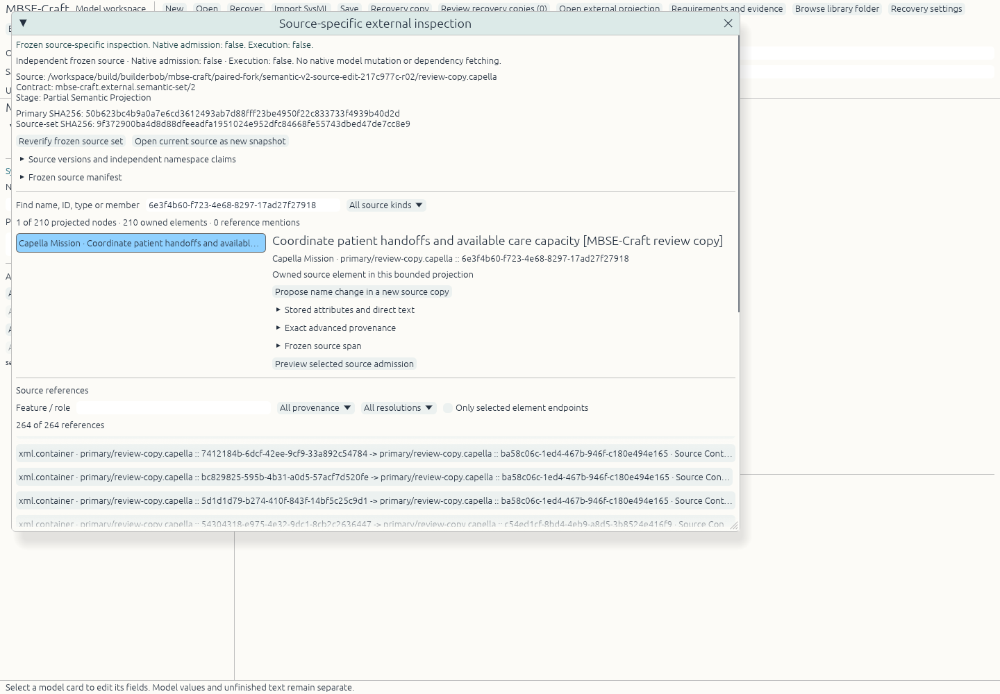
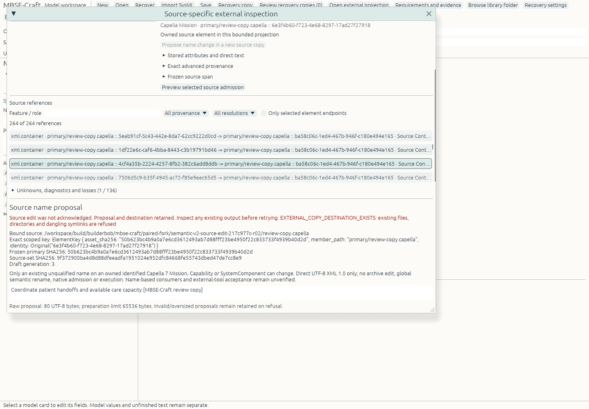

# Bounded Linux V2/source-edit milestone

Actual source epoch: integration HEAD `217c977cb12ff7de86e2748877886618becbdfcd` plus the then-uncommitted frozen core patch `6800a3d1d51cb9f7a487a1cfde594a0394d52182cf79db71668f397a7375389d`. Original UI source commit: `7df3b76800e0ab0eec1f407202875957fd684617`. The later code/documentation commits record those bytes; they do not retroactively change the tested epoch. SOURCE_MANIFEST.json was generated after staging the unchanged source files, including formerly untracked core files. Documentation is excluded from that build-input hash.

The core wave passed 50 focused tests. The integrated UI wave then ran exactly the six recorded controller tests (14 unrelated desktop tests filtered out) and built with Rust 1.99.1, one Cargo job, locked offline dependencies. No new dependency version or lock change was introduced. Binary SHA256: `4df50cf94f84200b9461fbb64f00f07b36d7a493dec1a5abb90e8e89264a901f`. The earlier core-only `9143f36a` binary and every prior epoch remain distinct preserved artifacts.

One same-owner private Linux X11/Xvfb renderer ran 2026-10-23T04:31:38.437912Z through 04:38:30.880953Z, using the existing reviewed XTest driver and software OpenGL at 96 DPI. Actual pointer/keyboard input opened the authorized Capella source, selected its real owned Mission ID/type, retained a review-label proposal across selection and app/inspector close cancellation, prepared the exact name value, created a NEW copy, then explicitly reopened that copy through its expected source-set digest. An existing destination was refused visibly while its proposal remained retained. Exact raw copy of the original succeeded. An independent native document saved/reopened with the same snapshot hash; no external model was admitted. App and driver exited0; the owned X server was reaped and Xauthority removed.

The original source SHA256 remained `2d83896463118c73e815937b2f5fa10906d8d46a4e8b96f2b8656a2f3f0cc7cd`; the new XML copy is 54,627 bytes, SHA256 `50b623bc4b9a0a7e6cd3612493ab7d88fff23be4950f22c833733f4939b40d2d`. A same-owner second-parser comparison proved exactly one name attribute changed: original span45011..45066, encoded value55->80bytes, identical prefix/suffix outside that value, all210stored ID values/positions/QNames and805other attribute values retained. This establishes stored reference spelling and local target identity preservation; no external reference resolution or engineering validity is inferred. The XML comparison counts226elements; the native projection displays210source nodes. Those are different inventories, not conflicting counts.

The two selected actual application captures are authorized private-repository documentation. Their originals, all other reference screenshots, original/private Capella assets, generated review XML and raw-copy XML remain outside Git. The included native-independent.kernspan is the app's blank synthetic native document, not a converted Capella model. PNG capture timestamps in NATIVE_RECEIPT.json use actual file modification times; the older driver's event log has no separate UTC field.

## Scope and remaining gates

This is a source rename, not global semantic refactoring. The supported edit classes are owned identified ctx/7.0.0 Mission, Capability and SystemComponent with an existing unqualified name in direct UTF-8 XML1.0. The actual native example is one Mission; the other supported classes and quote/entity/BOM/Unicode/XML-version cases have focused test evidence, not matching native usability coverage. No archive rewrite, companions/open_set, native editable admission, general SysML/Arcadia validation, simulation or external-tool acceptance is claimed. Source bodies/formulas remain unevaluated.

Native stale-source/output races, late-leaf/dangling-link races, and a live post-write-read-failure fixture were NOT RUN. Their core/controller tests remain separate and are never credited as actual native failure proofs. Parent/layout/IME/compositor/Wayland/otherOS/physical-performance/accessibility and engineering acceptance remain open. Hard-link-only placement refuses filesystems without that operation; arbitrary ancestor-directory replacement is outside its destination-leaf guarantee. Directory sync after placement remains best effort as in Craft.

Raw command logs are archived byte-for-byte as `.log.gz`; LOG_ARCHIVES.json records archive and decompressed SHA256 identities. This avoids altering original evidence to satisfy documentation whitespace checks. Workspace originals and earlier receipts remain unchanged.
