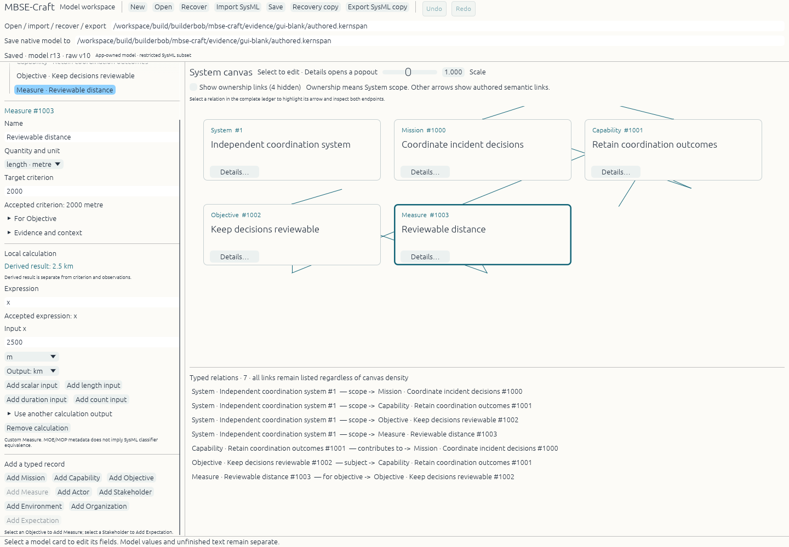
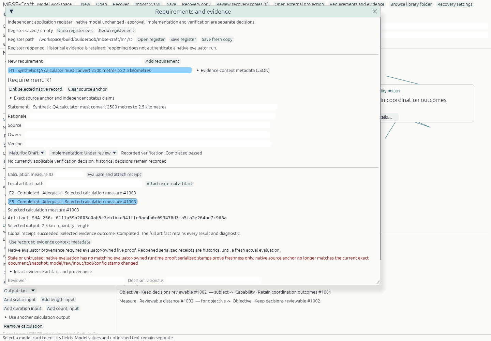

# Historical contributor page before main promotion

Preserved from PR #63 integration. Branch, publication and acceptance statements below describe that earlier snapshot; use the current [README](../../README.md) and [contribution guide](../../CONTRIBUTING.md) for development. Relative links are adjusted for this archive location.

# MBSE-Craft

An independent native Rust systems-modeling workbench. It reuses the attributed MIT Kernspan Stage1 core and integrates pinned ArtCraft persistence, UI controls, settings, quit, document-path and window-frame contracts. It has its own native shell and preserves the bounded Kernspan storage and exchange profiles; it is not a full ArtCraft application or general SysML implementation.

## Current development and contribution

The integrated development branch is `implementation/native-alpha`, through P39 in [PR #62](https://github.com/ajhcs/mbse-craft/pull/62). The 58-position roadmap has 39 merged implementation positions; P40–P58 remain. Splitting positions can require additional PRs. Bounded implementation evidence does not close the 56 broad acceptance specifications or integrated milestone exits.

Start with [CONTRIBUTING.md](../../CONTRIBUTING.md) for branch selection, isolated development, build prerequisites and review evidence. [Publication readiness](../../docs/PUBLIC_READINESS.md) records the prepared default-branch handoff and the material already retained in history. `main` is currently a skeleton; [PR #1](https://github.com/ajhcs/mbse-craft/pull/1) is the proposed promotion of the integrated work. Repository visibility has not been changed by this handoff.

The latest native import workflow reviews an explicit source member and target System, requires disclosures, then applies one native Undo/Redo transaction. It preserves source bytes and native drafts; its strict synthetic UML subset and documentary Block mapping do not establish vendor No Magic interoperability. See [P39c evidence and exact limitations](../../docs/parity/p39c/README.md). Older qualification sections below describe their original frozen epochs.

## Build on Linux

The package metadata declares Rust 1.97; the recorded build and test toolchain is Rust 1.99.1. The declared minimum has not been independently tested. The native GUI uses eframe/egui 0.36.2 with X11/OpenGL. Linux needs X11, keyboard and OpenGL runtime libraries; private test display uses an already installed Xvfb. No MySQL, Redis, Node, provider credentials or ArtCraft service is needed for this offline integration.

Keep source, cache, temporary state and build output under Samsung-backed `/workspace` on BuilderBob. The implementation is on the `implementation/native-alpha` branch in [draft PR #1](https://github.com/ajhcs/mbse-craft/pull/1); the default `main` branch is a skeleton. Use a separate checkout of that branch. The following example uses a fresh development checkout and output directory; choose unused paths and verify Samsung storage before creating them. Existing frozen alpha, M1 and paired epoch directories must be preserved:

```bash
git clone --branch implementation/native-alpha --single-branch https://github.com/ajhcs/mbse-craft.git /workspace/repos/builderbob/mbse-craft-dev
cd /workspace/repos/builderbob/mbse-craft-dev
mkdir -p /workspace/build/builderbob/mbse-craft-dev/{target,tmp,state,config} /workspace/cache/builderbob/mbse-craft-dev
export CARGO_HOME=/workspace/cache/builderbob/mbse-craft-dev
export CARGO_TARGET_DIR=/workspace/build/builderbob/mbse-craft-dev/target
export TMPDIR=/workspace/build/builderbob/mbse-craft-dev/tmp
export MBSE_RUST_BIN=/workspace/cache/builderbob/global-tools/rustup/toolchains/1.99.1-x86_64-unknown-linux-gnu/bin
bash scripts/dev.sh build --locked -p mbse-desktop
bash scripts/dev.sh test --locked --workspace
/workspace/build/builderbob/mbse-craft-dev/target/debug/mbse-desktop --state-dir /workspace/build/builderbob/mbse-craft-dev/state --config-dir /workspace/build/builderbob/mbse-craft-dev/config
```

BuilderBob’s generic Cargo/Rust wrappers override CARGO_HOME; this script uses the exact installed toolchain binaries to preserve isolation. Set `MBSE_RUST_BIN` to your installed toolchain directory on another machine.

The first dependency resolution requires existing registry access or an available isolated cache. Review dependency/build scripts before execution in restricted environments. `scripts/dev.sh` fixes one Cargo build job and refuses absent explicit output/cache/temp paths. No upstream release, signing or provider workflow is run.

## Modeling workflow

Start with a System, edit its name/purpose in the left controls, and add typed records. Missions describe intended accomplishment; capabilities reference same-System missions; objectives choose a typed System/Mission/Capability subject; Measures belong to explicit Objectives. Select cards in the canvas to edit, or open Details. The relation ledger lists every projected typed link, including links whose canvas captions would be crowded.

Accepted model values and incomplete raw drafts remain separate. Save/reopen/recovery preserve both. Native save status acknowledges the frozen model/raw generation. Recovery opens an independent dirty draft. Native `.kernspan` schema2 is retained for the shared bounded core; the separate application name does not imply a new general interchange format.

Calculations use the inherited bounded scalar/ratio/count/length/duration/speed evaluator and named typed inputs. Results are derived values, separate from observations and engineering acceptance. No MATLAB, Wolfram, external execution, equation solver or general SysML simulation is provided. UI workflow details and current verification findings are recorded separately.

## Compatibility and provenance

- [Ordered parity roadmap](../../docs/PARITY_ROADMAP.md) and [capability matrix / synthetic acceptance specifications](../../docs/parity/README.md) — preparation only; no new product acceptance or full parity claim.
- [Implementation plan and acceptance criteria](../../docs/IMPLEMENTATION_PLAN.md)
- [Ten-repository source/license and compatibility matrix](../../docs/UPSTREAM_COMPATIBILITY.md)
- [Pinned upstream manifests](../../docs/UPSTREAM_SOURCES.json)
- [Model and persistence contract](../../docs/MODEL_CONTRACT.md)
- [Loaded guidance provenance](../../docs/GUIDANCE_PROVENANCE.json)
- [Kernspan source provenance](../../licenses/kernspan/PROVENANCE.json)
- [ArtCraft extraction hashes](../../vendor/craft-libs/SOURCE.json)

This candidate patches the complete egui 0.36.2 family to Storytold craft/0.36.2 pin `767b1cad` and winit 0.30.13 pin `ffae5198`. The resolved lock has one identity per family crate. The [sealed paired epoch](../../docs/paired-fork/verification/F1_F4_RECEIPT.json) passed 171 workspace tests on its initial paired source, then rebuilt the final label-only source `0c2665b` and passed bounded Linux X11 native checks. Those checks cover focus, editing, model/canvas Undo/Redo, save/reopen, separate 96/144 DPI displays, hidden dirty-close guards and recovery. The frozen M1 binaries use the prior registry graph. Storytold main 0.37 is not used. AI/service/plugin/launcher/CAD/font/catalog protocol compatibility is unqualified. The restricted `artcraft-services` workspace, unlicensed shared workflows and trademark assets are not bundled. `kernspan.stage1.sysml/1` exchanges only the closed custom domain profile, with atomic refusal of unsupported semantics; syntax success is not SysML conformance.

## Frozen alpha acceptance

Independent Linux verification passed 123 tests, including actual Craft streaming/rename fault preservation and corrupted-main recovery. Native workflows passed blank-model creation with typed links and a 2500 m to 2.5 km calculation, save/normal-close/relaunch; fixture-based invalid-draft preservation, typed relation edits, save failure/cancel safety, independent recovery and graceful close after keeping recovery. These are distinct fixture and blank-authoring checks, not general usability acceptance.

Exact build-input SHA-256: `323fe697051fe40a508dcab6d8d3979898a0da8c34a4a2007aa1ec30ee3ac6d7`. Linux debug executable SHA-256: `ddefaaaa73675b5e1aacd8aee6288cfdf513049c0e8cad88b15be894a7e4b587`. Build used Rust 1.99.1, one Cargo job, offline locked registry inputs, private Xvfb and software OpenGL. Recompute inputs with `python3 scripts/source-manifest.py`.

These frozen acceptance epochs are not a release. Windows native behavior, AT-SPI accessibility, physical FPS/input latency, engineering acceptance and full ecosystem compatibility remain unqualified. The canvas uses a responsive grid with basic crossing routes, explicit scope-link visibility and a complete relation ledger; this does not establish collision-free dense layouts. The continuation adds actor/environment/organization context editors and default-off periodic recovery; its evidence is recorded separately below. Generic CAD and service/AI integrations remain outside the implemented scope. See `docs/UI_WORKFLOW.md` and the independent acceptance artifacts under `docs/verification/`.

[Independent acceptance report](../../docs/verification/FINAL_ACCEPTANCE.md) · [machine-readable receipt](../../docs/verification/FINAL_ACCEPTANCE.json) · [exact source manifest](../../docs/verification/SOURCE_MANIFEST.json) · [blank-authored native model](../../docs/verification/models/blank-authored.kernspan)



## Continuation implementation and qualification

The continuation adds Actor, Stakeholder, Environment and Organization context records with affiliations. Recovery discovery is bounded; periodic recovery is explicitly enabled in preferences and defaults off. Pass `--config-dir` for persistent preferences and `--state-dir` for recovery state. Hidden dirty-close guards preserve model and raw drafts through cancellation. The frozen external library browser indexes retained source without changing the active native model. Bounded MDZIP/UML, Capella and SysML text projections expose typed IDs, properties, reference endpoints, source spans, unknown semantics and original bytes. A partial projection is not native editable admission or execution; AIRD layout fidelity remains unsupported.

The independent requirements/evidence window authors a separate JSON sidecar with retained raw drafts, Undo/Redo and distinct maturity, implementation and verification states. Native evaluator receipts retain selected output kind/unit and the complete global result. Adequacy and verification require explicit review. Reopening retains historical decisions and clears live evaluator authority; current stamps alone cannot authenticate execution. Local external artifacts remain explicitly attributed inert evidence.

Frozen continuation qualification includes 168-test native assurance/recovery and 169-test resource epochs, plus earlier actual context/recovery, preferences failure/retry, future-schema read-only settings, hidden dirty close and readable library-preview workflows. Source and binary identities differ from the frozen alpha. Receipts live under [continuation verification](../../docs/continuation-m1/verification/). The projection and requirements workflows have scoped native receipts indexed in [the freeze index](../../docs/continuation-m1/FREEZE_INDEX.json). Later audit-merge/draft corrections passed 26 focused tests. The [paired verification report](../../docs/paired-fork/verification/README.md) records the separate sealed 171-test source and final `0c2665b` native epoch; its evidence does not apply automatically to later semantic-adapter changes. Compositor minimize/restore and maximize, real IME composition, Wayland clipboard/drop/seat behavior, WGPU/tablet paths, other platforms, mixed physical monitors, assistive technology, physical performance and engineering acceptance remain unqualified. Hidden-window checks used explicit external unmapping/remapping on private Xvfb displays. These boundaries prevent a full interoperability or finished-product claim.

The additive semantic-set V2 core has [independent focused checks and actual reference coverage receipts](../../docs/continuation-m2/verification/README.md). It retains source-specific Capella/UML/profile types, scoped keys, role and resolution provenance, unknown semantics and original bytes. The [bounded Linux source-edit milestone](../../docs/continuation-m2/verification/epoch-217c977c-source-edit/README.md) adds retained name proposals and new-copy editing for an existing name on owned identified Capella ctx/7.0.0 Mission, Capability or SystemComponent in UTF-8 XML 1.0. Fifty focused core tests, six integrated UI regressions and a scoped desktop build passed. The actual native Mission workflow created and reopened a review copy while preserving the original and every byte outside its name value, refused an existing destination, and retained the independent native model. This is source rename only; archives, companions, global name refactoring, native editable admission and engineering acceptance remain unqualified. Earlier V2 core coverage receipts do not establish those later native outcomes.



## Licenses

Original app code is MIT. Reused Kernspan core retains its MIT copyright; the pinned syntax crate is Apache-2.0; Craft libraries are MIT OR Apache-2.0 with complete NOTICE/ATTRIBUTION retained. See [third-party notices](../../THIRD_PARTY_NOTICES.md). No upstream brand endorsement is claimed.

Experimental persistent native views are prepared on the separate `feature/native-views-m2b01` source branch. [M2B-01 adoption and held validation gate](../../docs/continuation-m2b01/ADOPTION.md) describes the implementation and its focused test/build receipt; the native multi-view workflow remains UNRUN. This source preparation does not extend any earlier binary or native-workflow qualification.

The preservation-fix source `09df25d` passed 30 focused model/persistence tests, eight desktop controller tests and the scoped desktop build. [Exact receipts and limits](../../docs/continuation-m2b01/verification-09df25d/README.md) preserve the earlier admission holds separately from Rust results. The [revised native gate](../../docs/continuation-m2b01/origin-paired-save-guard/REVISED-NATIVE-GATE.md) targets the new `199226d5` binary and remains unrun.
