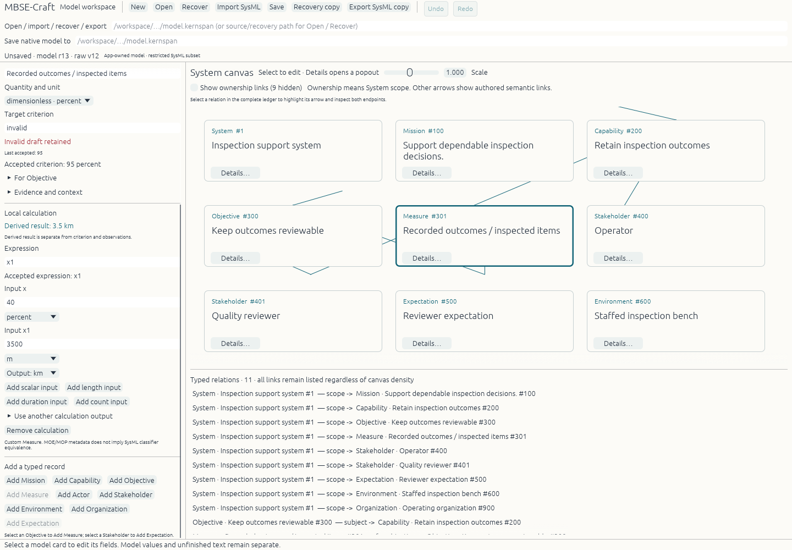

# Independent Linux native acceptance

The final candidate compiles and passes **122 unit/integration tests and one documentation test**, with zero failures. Its portable build-input SHA-256 is `323fe697051fe40a508dcab6d8d3979898a0da8c34a4a2007aa1ec30ee3ac6d7` (76 files). The actual tested debug binary SHA-256 is `ddefaaaa73675b5e1aacd8aee6288cfdf513049c0e8cad88b15be894a7e4b587`. Commands, environment, logs, individual artifact hashes and scenario scope are in [FINAL_ACCEPTANCE.json](FINAL_ACCEPTANCE.json).

Starting the real binary **without a fixture**, the independent verifier named a System and purpose; created Mission, Capability, Objective and Measure records; authored the Capability's Mission link and Objective's typed Capability subject; and authored a length calculation. A literal of **2500 m produced 2.5 km** while its criterion remained 2000 m. Save, normal WM_DELETE_WINDOW close (exit 0), and a fresh process reopening preserved identical snapshot hash `0f731187f6779bcd591b7da80b25bf550fb09355e16534f24e79dc16967d2040`.

Separate fixture-assisted workflows verified real GUI relation Undo/Redo, invalid criterion text retained beside accepted 95, failed load/cancel preservation, and a visible failed save without a Saved claim. The failed save attempted a prior run's deliberately read-only input; no filesystem repair was performed. Real Craft atomic streaming and rename failures are exercised independently by tests, preserving old destination bytes. The GUI used actual `craft-ui` IconButton and palette calls; resolved dependency evidence shows one registry egui 0.36.2 family, shared by application and Craft UI.

A separate final-binary dirty navigation check saved the edited current 2600 m value to its owned destination, then refused the corrupted Open input unchanged. The active model remained saved, its preservation prompt dismissed, and it closed normally.

For recovery, the verifier preserved then truncated an owned saved main file. The actual executable refused malformed JSON, and the GUI restored the independently written recovery as a dirty document. The retained 3500 m input produced **3.5 km**, and a fresh owned native save succeeded. A dirty WM_DELETE_WINDOW close prompted preservation; **Keep recovery and continue wrote a current recovery and exited normally**, without a loop.

Each GUI run used a fresh authenticated private Xvfb server and software GL. The driver binds its target window to the exact child PID, sends real XTest pointer/keyboard events, captures actual XGetImage pixels, and records process exit. App-emitted geometry is used only to target controls. It does not replace native input, saved-byte inspection or pixel evidence. Only owned app/server children were terminated or closed; other displays and jobs were untouched.

The final screenshots and saved synthetic documents are evidence of these bounded Linux workflows. Windows, AT-SPI/screen readers, physical FPS/input latency, general usability or engineering acceptance, full SysMLv2, power-loss durability, Storytold egui fork and hosted ArtCraft services remain unqualified. The Measure quantity chooser exposes fewer options than the underlying calculation core. Canvas routing and viewport usability remain prototype limitations; complete typed references remain in the ledger and scrollable controls.
